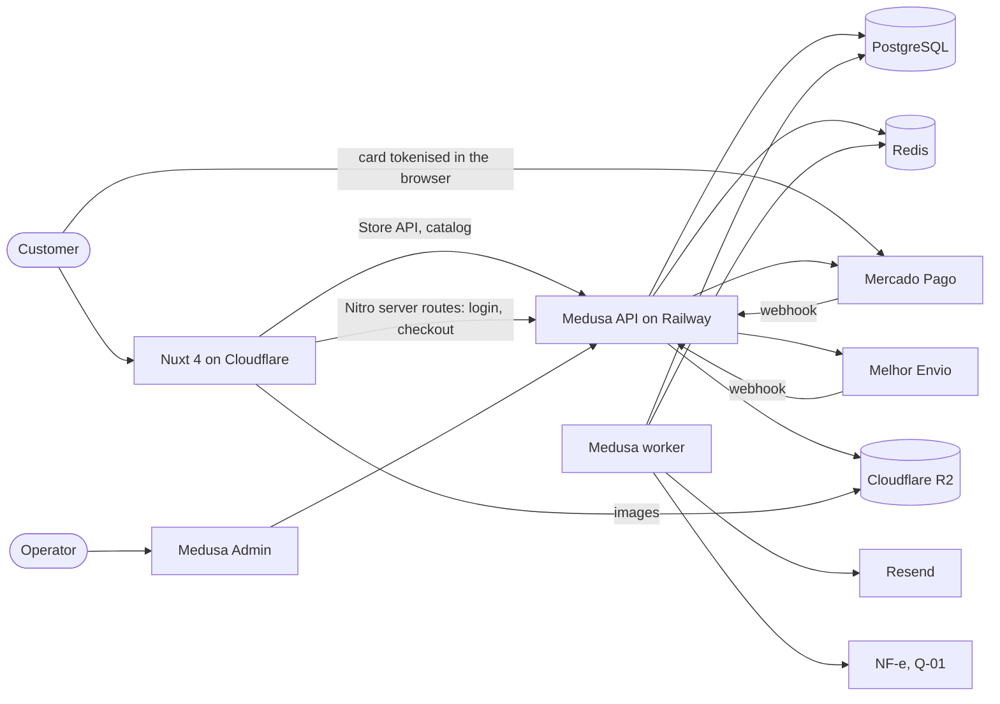
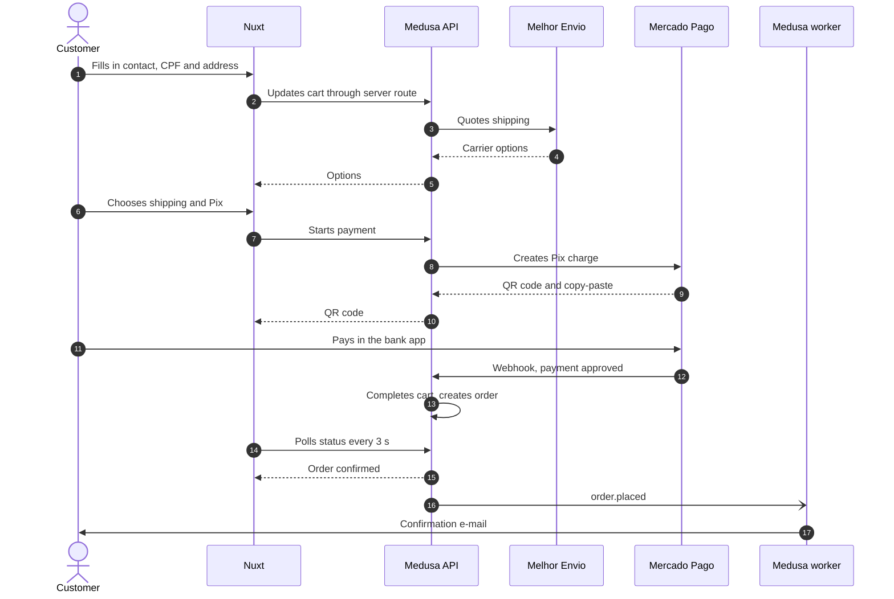
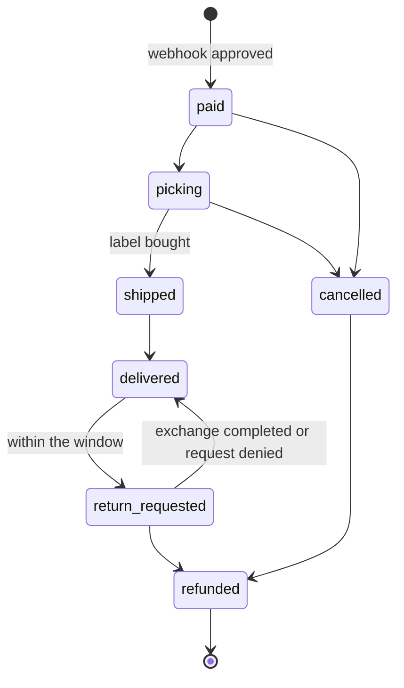

# 04 - Architecture

The store is a Nuxt 4 storefront in front of a Medusa v2 backend, in one monorepo. Decisions are in
[ADR 001](adr/001-nuxt-medusa-stack.md) and [ADR 002](adr/002-mercado-pago-on-site-payment.md).

## Components



## Repository structure

```
nozco-store/
├─ apps/
│  ├─ backend/              # Medusa v2
│  │  ├─ src/
│  │  │  ├─ api/            # custom routes (store/, admin/, hooks/)
│  │  │  ├─ modules/        # content, invoice
│  │  │  ├─ providers/      # mercadopago, melhorenvio, resend
│  │  │  ├─ workflows/      # checkout, fulfillment, refund
│  │  │  ├─ subscribers/    # order and payment events
│  │  │  ├─ jobs/           # reconciliation and other scheduled jobs
│  │  │  ├─ links/          # module links (order to invoice)
│  │  │  └─ admin/          # Medusa Admin extensions
│  │  └─ integration-tests/
│  └─ storefront/           # Nuxt 4
│     ├─ app/               # pages, layouts, components, composables, stores
│     ├─ content/           # institutional pages in Markdown
│     ├─ i18n/locales/      # pt-BR.json
│     ├─ server/api/        # BFF routes
│     ├─ shared/            # schemas used by app and server
│     └─ tests/
├─ packages/
│  ├─ shared-types/         # types and Zod schemas used by both apps
│  └─ eslint-config/
├─ infra/                   # docker-compose, Dockerfile
└─ .github/workflows/
```

## Payment and order sequence



The QR code alone confirms nothing: the order exists only after the webhook. The rule for an approved
payment with no stock left is pending in Q-04.

## Order states



## Environments

| Environment | Storefront | Backend | Trigger |
|---|---|---|---|
| Local | `nuxt dev`, mock or api source | Medusa with Postgres and Redis, when available | Manual |
| Preview | Cloudflare preview per PR | Staging API, or mock source | Pull request |
| Staging | Cloudflare | Railway, sandbox credentials | Merge to `develop` |
| Production | `nozco.com.br` | Railway, production credentials | Tag on `main` |

The branch names above take effect in EST-01.3, which adopts `develop` and `main` as in the tabacaria.
